# 6-bit 1-MS/s SAR ADC (500 nm CMOS)

2026년 제2회 내 칩(My Chip) 경진대회 출품작입니다. 500 nm CMOS 공정으로 6-bit 1-MS/s 동기식 SAR ADC를 설계하고, layout과 PEX(parasitic extraction)를 거친 post-layout simulation으로 검증했습니다.

## 핵심 성능 (post-layout, 5 V, 1 MS/s, fin = 98.63 kHz)

| 항목 | Pre-layout | Post-layout |
|---|---|---|
| Architecture | SAR (synchronous, single-ended) | SAR (synchronous, single-ended) |
| Process | 500 nm CMOS | 500 nm CMOS |
| Resolution | 6 bit | 6 bit |
| Supply | 5 V | 5 V |
| Sampling rate | 1 MS/s | 1 MS/s |
| SNDR | 37.82 dB | **37.23 dB** |
| SFDR | 50.69 dBc | **55.06 dBc** |
| ENOB | 5.99 bit | **5.89 bit** |
| Power | 0.764 mW | **2.421 mW** |
| FoM<sub>W</sub> | 12.0 pJ/conv-step | **40.8 pJ/conv-step** |
| Area | – | 0.45 mm² (790 μm × 573.5 μm) |

$$
\mathrm{FoM_W} = \frac{P}{f_s \cdot 2^{\mathrm{ENOB}}}
$$

ENOB는 약 0.1 bit만 떨어졌지만, 소비 전력은 약 3.17배, FoM<sub>W</sub>는 약 3.4배 커졌습니다. Layout 기생 성분 때문에 선형성이 감소할 수 있고 소비전력이 증가 할 수도 있지만 소비전력이 약 3배 증가한건 기생성분의 영향뿐만 아니라 다른 영향도 있을 것이라 판단됩니다.

## 회로 구성

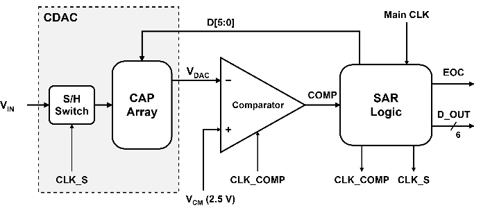

Sampling switch(S/H), CDAC, 비교기, SAR logic의 네 블록으로 구성됩니다.

### 1. Sampling switch: CMOS transmission gate

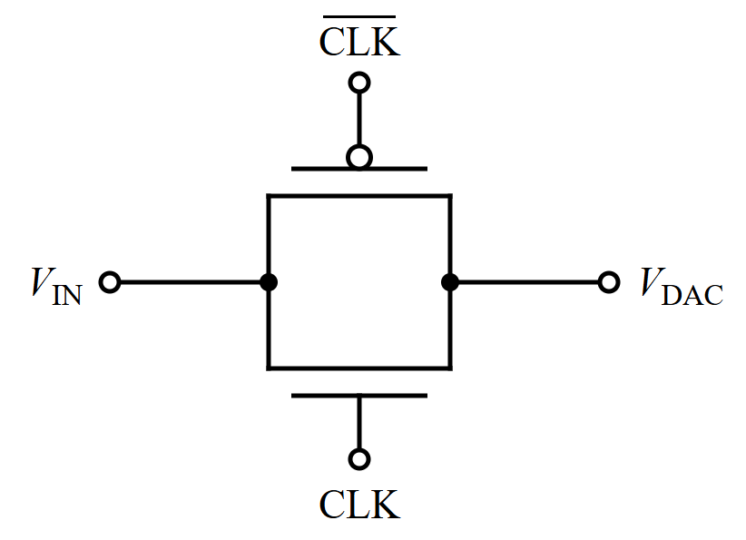 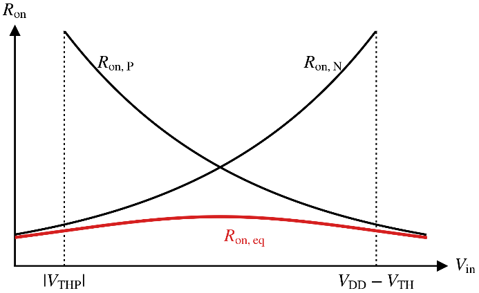

- 단일 NMOS/PMOS 스위치는 Vin이 VDD 또는 VSS 근처일 때 V<sub>GS</sub> < V<sub>TH</sub>가 되어 꺼집니다. 두 소자를 병렬로 묶어 전체 입력 범위에서 R<sub>on</sub>을 낮췄습니다.
- NMOS W/L = 2 μm / 0.5 μm, Wp:Wn = 3:1입니다. Wp:Wn = N(1~4)으로 sweep해 R<sub>on</sub> 변동폭과 SNDR을 비교한 뒤 정했습니다.
- Layout에는 substrate noise와 latch-up을 막기 위해 guard ring을 넣었습니다.

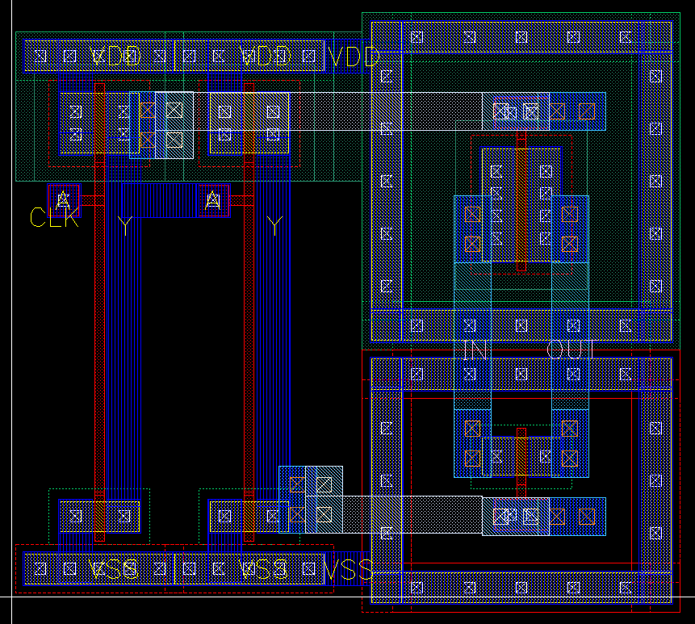

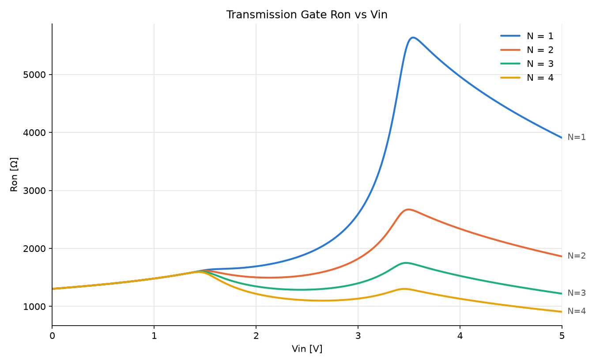

### 2. CDAC: binary-weighted, top-plate sampling

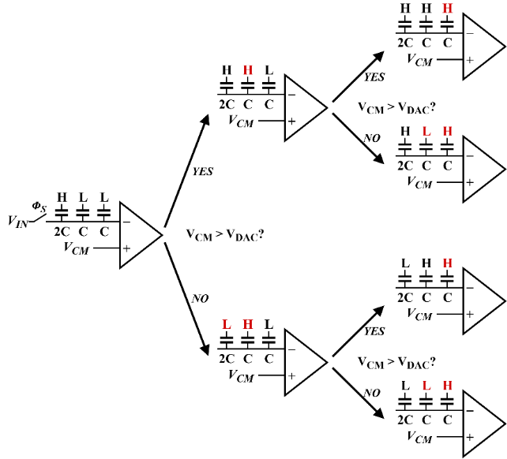

- Sampling 뒤 각 capacitor의 bottom plate를 VREFH 또는 VREFL로 바꿔 top plate 전압을 만들고, 이 전압을 VCM = 2.5 V와 비교합니다. 위 그림은 동작을 3-bit로 줄여 나타낸 것입니다.
- Unit capacitor는 112.5 fF(15 μm × 15 μm PIP)이고, 2<sup>6</sup> = 64개로 total 7.2 pF입니다.
- Mismatch를 줄이기 위해 common-centroid로 배치했습니다.

#### Unit capacitor 크기 선정

CDAC 출력 전압은 capacitor ratio로 정해지므로 capacitor matching과 parasitic capacitance의 영향이 큽니다.

- **Unit capacitor가 클 때**: kT/C noise와 parasitic의 상대적 영향이 줄어듭니다. 대신 settling time, layout 면적, 소비 전력, sampling switch 구동 부담이 늘어납니다.
- **Unit capacitor가 작을 때**: 면적과 전력은 줄지만, mismatch와 parasitic의 영향이 상대적으로 커집니다.

V<sub>REF</sub> = 5 V일 때 1 LSB는 78.125 mV입니다.

- kT/C noise와 quantization noise만 고려해 필요한 total capacitance를 계산하면, 공정의 PIP capacitor 최소값보다 훨씬 작은 값이 나옵니다.
- 그런데 최소 크기로 설계하면 비교기의 kickback noise 때문에 SNDR이 떨어지는 것을 시뮬레이션으로 확인했습니다.
- layout 이후 생기는 기생 성분의 영향도 무시할 수 없습니다.

그래서 kickback, settling time, sampling switch 부담 사이의 trade-off를 고려해 unit capacitor를 **112.5 fF**로 정했습니다. 이때 total capacitance는 약 7.2 pF이고, kT/C noise는 약 23.98 μV로 1 LSB보다 충분히 작습니다.

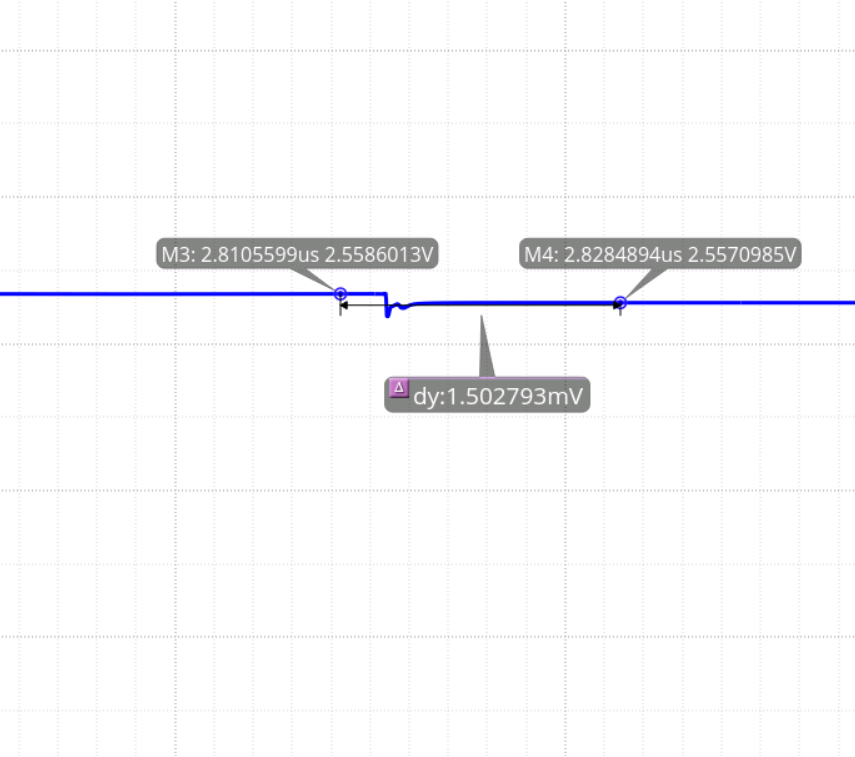 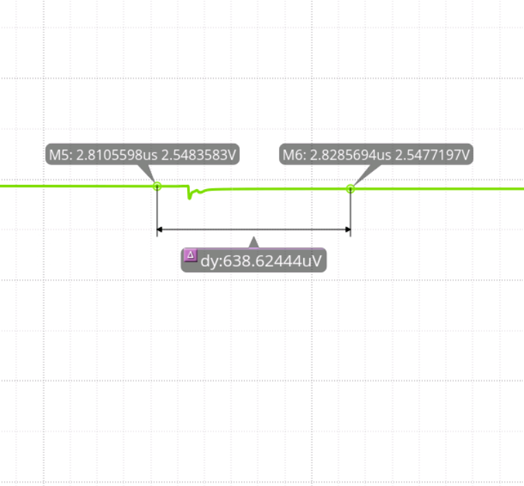

| C<sub>unit</sub> | 비교기 동작 시 V<sub>DAC</sub> 변화 |
|---|---|
| 50 fF (왼쪽) | 1.50 mV |
| 112.5 fF (오른쪽) | 0.64 mV (약 57.3% 감소) |

비교기가 동작하는 순간의 V<sub>DAC</sub> 흔들림을 비교한 pre-layout 시뮬레이션 결과입니다.

#### CDAC layout

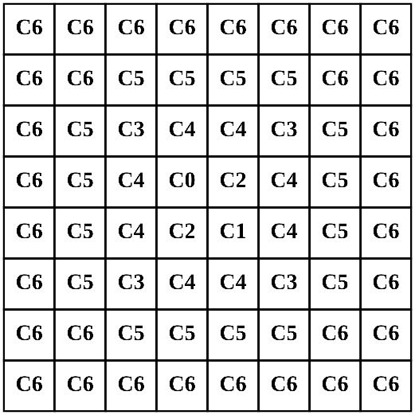 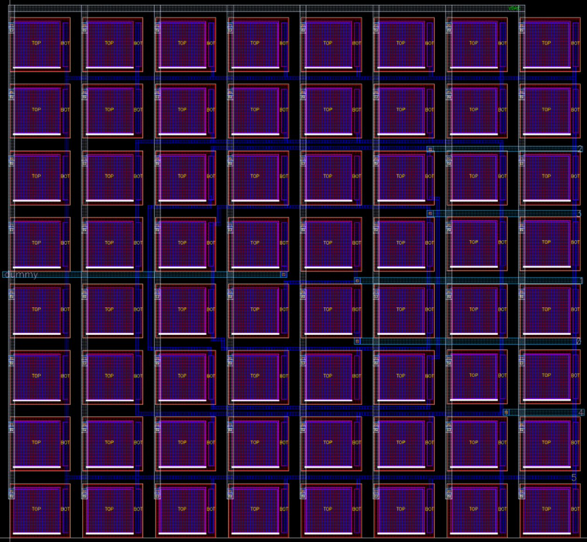

왼쪽은 common-centroid 배치표, 오른쪽은 이 배치표대로 그린 capacitor array layout입니다.

### 3. 비교기: StrongARM latch + SR latch

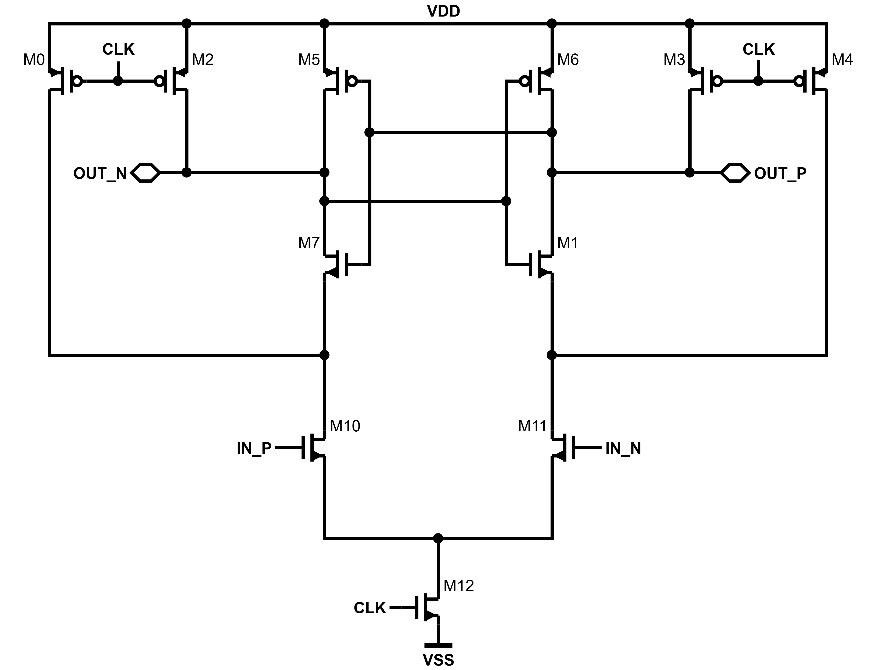

- Dynamic latch 구조여서 VDD에서 VSS로 흐르는 DC 경로가 없고, 정적 전력도 거의 없습니다.
- 입력 트랜지스터를 최소 크기로 만들어 clock feedthrough와 kickback noise를 줄였습니다.
- 출력에 NAND 기반 SR latch를 달아, 결정된 값을 다음 비교 때까지 유지합니다.
- Layout은 mismatch를 줄이도록 좌우 대칭으로 그렸고, guard ring으로 외부 간섭을 막았습니다. 아래 그림에서 위쪽이 SR latch, 아래쪽이 StrongARM latch입니다.

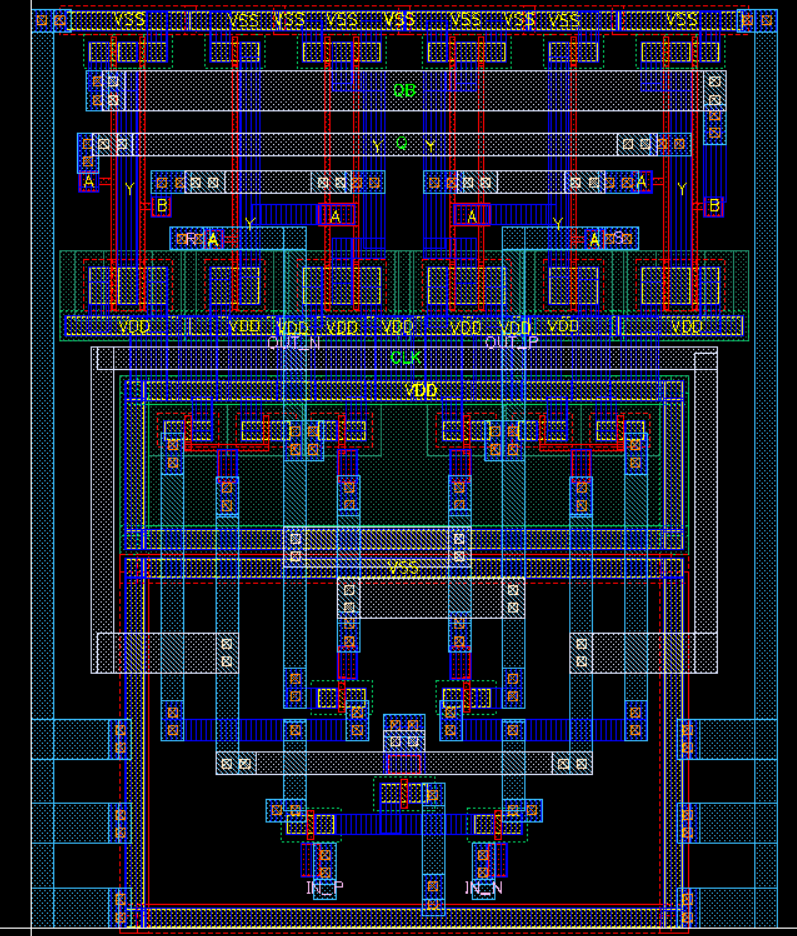

### 4. SAR logic: 동기식, DFF 기반

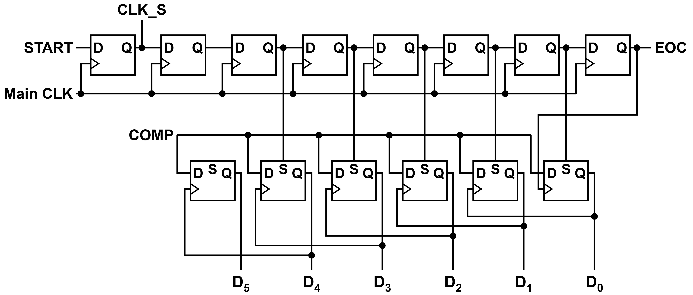
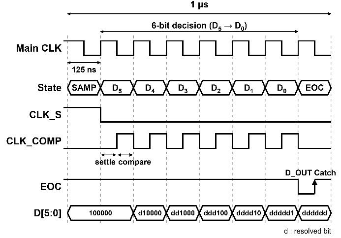

- 외부 Main CLK에 동기화되어 CLKs(sampling), CLKc(비교기), D5~D0(CDAC bottom-plate switch) 신호를 만듭니다.
- EOC(End Of Conversion)의 positive edge에서 최종 6-bit 코드를 출력합니다.

## Layout

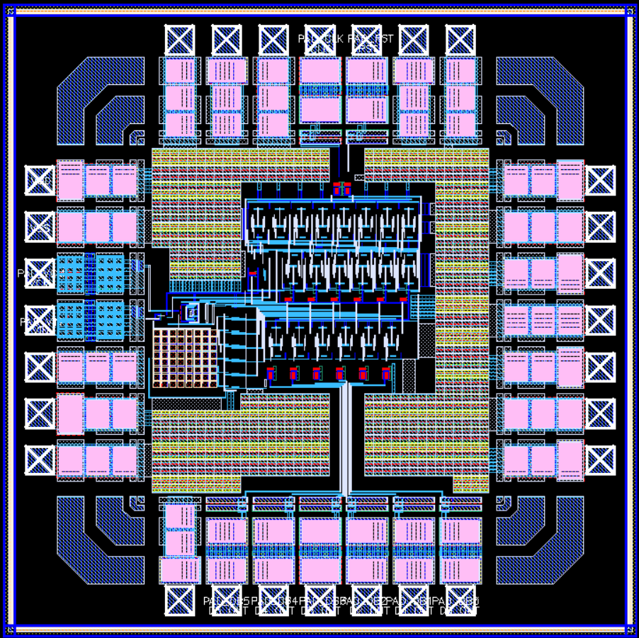

28-pin SOP 패키지로 tape-out했습니다. ADC 코어 면적은 790 μm × 573.5 μm입니다.

## 시뮬레이션 결과: FFT

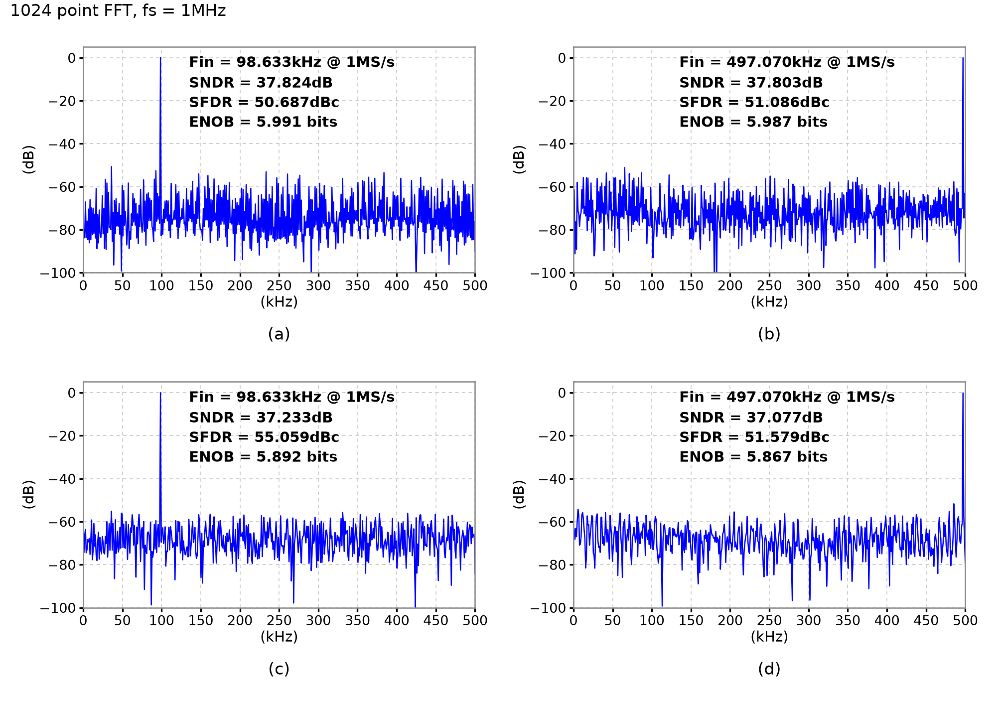

1024-point coherent FFT, f<sub>s</sub> = 1 MS/s 조건입니다. (a)(b)는 pre-layout, (c)(d)는 post-layout 결과이고, (a)(c)는 fin = 98.6328125 kHz, (b)(d)는 fin = 497.0703125 kHz(Nyquist 부근)입니다.

| | fin | SNDR (dB) | SFDR (dBc) | ENOB (bit) |
|---|---|---|---|---|
| (a) Pre | 98.633 kHz | 37.824 | 50.687 | 5.991 |
| (b) Pre | 497.070 kHz | 37.803 | 51.086 | 5.987 |
| (c) Post | 98.633 kHz | 37.233 | 55.059 | 5.892 |
| (d) Post | 497.070 kHz | 37.077 | 51.579 | 5.867 |

- Nyquist 부근 입력의 SNDR은 저주파 입력보다 0.156 dB 낮을 뿐이어서, 입력 주파수가 올라가도 성능이 거의 떨어지지 않습니다.
- Post-layout SNDR은 pre-layout보다 0.591 dB 낮습니다. 블록별로 PEX를 따로 돌려 보니 CDAC 배선 기생 성분이 capacitor ratio를 틀어지게 한 영향이 가장 컸습니다.

## 시뮬레이션 결과: 정적 선형성 (DNL / INL)

Post-layout ramp 시뮬레이션(0 → 5 V)에 code-density(histogram) 방식을 적용했습니다. End code(0, 63)는 빼고 endpoint 보정을 했습니다.

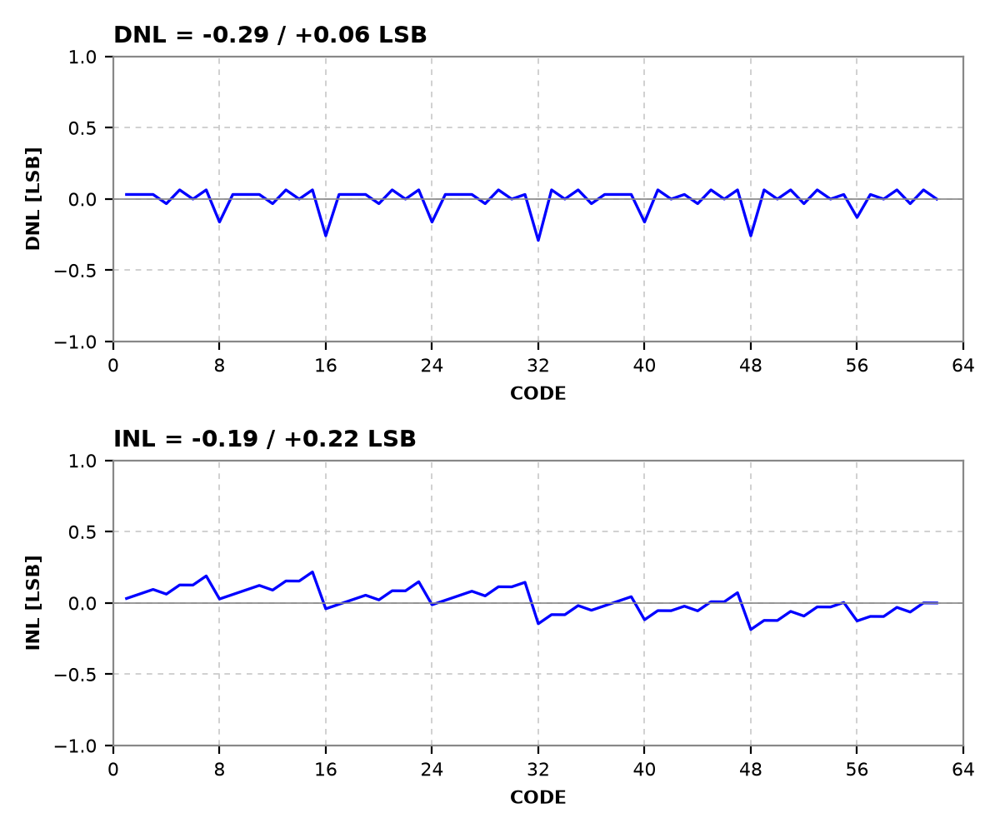

| hits/code | DNL (LSB) | INL (LSB) | Missing code |
|---|---|---|---|
| 16 | −0.29 / +0.10 | −0.18 / +0.22 | 없음 |
| 32 | −0.29 / +0.06 | −0.19 / +0.22 | 없음 |

## 저장소 구성

```
.
├── circuit_schematic/       블록별 회로도 (PNG + draw.io 원본)
│   ├── top/                 SAR ADC 전체 블록 다이어그램
│   ├── sampling_switch/     CMOS transmission gate
│   ├── cdac/                binary-weighted CDAC 스위칭 동작
│   ├── comparator/          StrongARM latch
│   └── sar_logic/           동기식 SAR logic, 타이밍도
├── circuit_testbench/       시뮬레이션 결과 (그래프 + 데이터 + 스크립트)
│   ├── sampling_switch_ron/ TG Ron-Vin sweep (Wp:Wn = 1~4)
│   ├── cdac_unit_cap/       unit capacitor 크기별 비교기 kickback (VDAC 변화)
│   ├── fft/                 pre/post-layout FFT 스펙트럼 (98.63 kHz, 497.07 kHz)
│   └── inl_dnl/             code-density 방식 DNL/INL
└── layout/                  칩 전체와 블록별 layout
```

## 한계와 향후 연구

- 실물 칩 측정과 corner simulation은 아직 하지 않았습니다.
- Post-layout에서 전력이 3.17배로 늘어난 원인을 분석해 layout을 최적화해야 합니다.
- 다음 설계에서는 fully differential 구조, bootstrap switch, bottom-plate sampling, monotonic switching[5] 등을 적용해 저전력 SAR ADC를 설계할 계획입니다.

## 참고문헌

1. B. Murmann, "ADC Performance Survey 1997–2024," https://github.com/bmurmann/ADC-survey
2. P. Harpe, "Successive Approximation Analog-to-Digital Converters: Improving Power Efficiency and Conversion Speed," *IEEE Solid-State Circuits Mag.*, vol. 8, no. 4, pp. 64–73, 2016.
3. B. Razavi, "The StrongARM Latch," *IEEE Solid-State Circuits Mag.*, vol. 7, no. 2, pp. 12–17, 2015.
4. J.-K. Lee *et al.*, "A 6 Bits 1 MS/s SAR ADC With a Power-Efficient Complementary Dynamic Amplifier," *Proc. IEIE Summer Conf.*, 2024, pp. 3279–3281.
5. C.-C. Liu *et al.*, "A 10-bit 50-MS/s SAR ADC With a Monotonic Capacitor Switching Procedure," *IEEE JSSC*, vol. 45, no. 4, pp. 731–740, 2010.

## Acknowledgement

이 연구는 과학기술정보통신부 반도체설계검증 인프라활성화사업(RS-2023-00258732)의 지원을 받았습니다.
